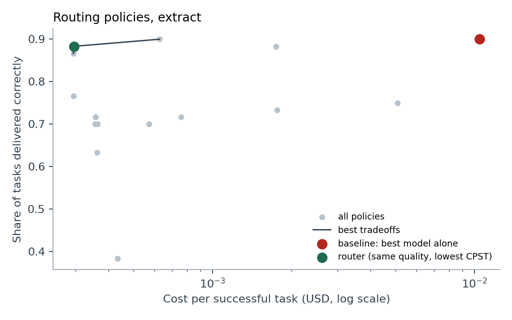

# CPST: cost per successful task

**The problem.** When an AI call fails (wrong answer, broken JSON, code that does not pass its tests) you retry, rephrase, or escalate to a bigger model, and you pay for every token along the way. Per-token billing charges the same for a failed attempt as for a successful one, so the customer carries all of the failure risk and nobody measures what a *finished* task actually costs.

**The metric.** Cost per successful task (CPST) = total spend ÷ answers that were actually correct. It includes retries, escalations, and failures, which per-token prices hide.

**The tool.** Three pieces that share one log format:

1. **A benchmark** that runs several models on tasks with automatic checkers and logs every call: fresh, cached, and output tokens, the provider's reported dollar cost, whether the checker accepted the answer, and whether the answer was actually right.
2. **A router** that starts with a cheap model, checks each answer, and escalates only when the checker rejects it. The benchmark replays every routing policy from one set of logs and picks the cheapest one that matches the best model's quality.
3. **A per-success biller** that prices each successful task at a target margin, shows what the customer saves versus per-token billing, and estimates the provider's risk of losing money on a batch.



*(Mock data above. Replace it with a real run before presenting.)*

## Quickstart

```bash
cd cpst
pip install -r requirements.txt

# 1. Offline demo: no API key, about 30 seconds, numbers are simulated
python run.py --n 60 --out runs/mock.jsonl
python report.py runs/mock.jsonl --out results/mock
open results/mock/dashboard.html

# 2. Real run through OpenRouter (one key covers every model)
export OPENROUTER_API_KEY=...
python run.py --models deepseek-v4-flash,deepseek-v4-pro,claude-haiku-5.5,claude-sonnet-5.5 \
    --families code,extract --n 30 --d 3 --max-usd 10 --out runs/real1.jsonl
python report.py runs/real1.jsonl --out results/real1

# 3. Run the chosen policy live on held-out invoices and print the bill
python examples/live_router.py --stages deepseek-v4-flash:2,claude-sonnet-5.5:2 --n 20

# Tests (offline)
python -m pytest tests -q
```

`--max-usd` is a hard stop: no new calls start once spend reaches the cap. Logs are written line by line, so a partial run is still analyzable.

**Estimated cost of step 2:** at most 4 models × 60 tasks × 3 tries = 720 calls, and most tasks stop after the first try. The DeepSeek models and Haiku 5.5 cost fractions of a cent per call. Sonnet 5.5 has thinking always on, so its output tokens (billed at $10 per million) dominate: expect a few dollars in total. Check `runs/real1.jsonl` after the first minute to confirm.

## Reading the dashboard

The dashboard is the product: a tool for anyone paying for AI work, and the evidence for our answer to Question 1.

1. **Pick the kind of work** (writing code, simple invoices, tricky invoices) and read the one-sentence recommendation.
2. **Set what mistakes cost you.** A wrong answer that passes every check never shows up on the token bill, but you pay for it later. The recommendation updates as you move the slider.
3. **Compare the options** as price stickers: cost per correct answer in large type, how often each one was right or looked right but was wrong, and whether it is open-weight or proprietary.
4. **Add up every buyer’s choice.** The Question 1 panel totals the recommended choice for all three kinds of work and shows the open-weight share of tokens and of spending, next to Vercel gateway data and our October 2027 forecast (edit those figures in `market.json`). As mistakes get more expensive, money moves to proprietary models while tokens stay with open models: the split in our answer, produced by individual purchase decisions.
5. **Watch the meter.** A ledger of every task and call shows each number’s source.
6. **For providers** (collapsed): the same work billed per token versus per correct answer.

The benchmark explains the mechanism behind the market split; it does not measure the split itself, which only gateway data can.

**Recommended lineup for a Q1 run:** two open-weight models (`deepseek-v4-flash`, `deepseek-v4-pro`), a cheap proprietary model (`claude-haiku-5.5`, which tests the counterargument that frontier labs can ship cheap models too), and a frontier model (`claude-sonnet-5.5`).

## What is in here

| File | What it does |
|---|---|
| `families.py` | Task families, each with a **checker** (what production can see) and a **grader** (ground truth). `code` reuses the teammate's HumanEval loader and sandboxed test runner from `../q5_harness`. `extract` generates business invoices with known answers and optional distractors (an old quote, last year’s tax rate, an extended due date, an earlier unpaid invoice). |
| `providers.py` | Metered clients for OpenRouter, Anthropic, and an offline mock. Prefers OpenRouter's reported `usage.cost`; falls back to list prices in `models.json`. Separates fresh, cached, and cache-write input tokens. |
| `models.json` | Model registry: provider, model ID, open or proprietary weights, fallback prices, optional reasoning effort. Add models here. |
| `market.json` | Gateway evidence and the team forecast for Q1, embedded in the dashboard. |
| `run.py` | Runs every model on every task once, with checker-driven retries, and logs every step. |
| `policies.py` | Replays the logs under single-model and cascade policies; computes CPST, waste, false accepts, escalation, bootstrap confidence intervals, and the Pareto frontier. |
| `billing.py` | Per-success pricing, the spread a router creates, and the provider's loss risk per batch. |
| `report.py` | Writes `report.md`, `results.json`, charts, and the interactive `dashboard.html`. |
| `meter.py` | The production SDK: `Router` runs a policy live, `Meter` logs calls in the same schema and issues invoices. |
| `examples/live_router.py` | Out-of-sample check of a policy on new invoices, with a two-way bill. |

## How it works

**Checked versus correct.** Every call gets two judgments. The checker is what a real system can run without an answer key: unit tests, JSON schema, internal consistency (the total must equal subtotal plus tax), and grounding (every value must appear in the invoice). The grader compares against ground truth, which only a benchmark has. An answer that passes the checker but is wrong is a **false accept**: the customer receives a confident wrong answer and the agent never retries, because it thinks it is done.

**Run once, replay many times.** Like the teammate's latency harness, `run.py` pays for each call once. `policies.py` then evaluates every policy (each model alone with 1 to d tries, and every cheap-to-expensive cascade of 2 or 3 models) by replaying those logs. Comparing dozens of routing strategies costs nothing extra.

**Waste.** For each task, waste is every dollar that did not buy the correct delivered answer: failed tries, stages that were escalated past, and the whole cost of any false accept or give-up.

**Baseline and router.** The baseline is the most expensive model alone with full retries, which is what a careful customer does today. The router is the policy with the lowest CPST whose success rate is within 2 points of the baseline (`--tolerance`).

**Billing math.** To earn gross margin *m* per success, charge *P* = CPST ÷ (1 − *m*). A router can charge any margin up to 1 − CPST_router ÷ CPST_baseline and still save the customer money; that spread is the business. Risk comes from resampling batches of 100 tasks and counting how often revenue falls below cost.

## The hypothesis this tests

> Cheap models win wherever success is cheap to verify.

Routing to a cheap model is only safe if a checker catches its mistakes, because a caught mistake triggers a retry or an escalation, while an uncaught one ships. So the router's advantage should be largest on tasks with strong checkers (code with tests, clean invoices) and should shrink, or vanish, where plausible wrong answers pass the checker (invoices with distractors). The `extract` family varies exactly this: difficulty 0 has no distractors, difficulty 2 has four. The "Where cheap models stop being cheap" table in the report is the test.

This also explains public gateway data showing open-weight models carrying most tokens but a minority of spending: cheap models take the verifiable bulk work, and premium models keep the tasks where a wrong answer is expensive and hard to detect.

**What would prove it wrong:** cheap models matching the frontier's success at difficulty 2, or false-accept rates that do not rise with difficulty.

## Known limits (say these before a judge does)

- **Small samples.** 30 to 60 tasks per family gives directional results. The report prints 95% bootstrap intervals; quote them.
- **Code has no false accepts by construction.** HumanEval's tests are both checker and grader. A stronger design would check against the visible examples and grade against hidden tests.
- **Synthetic invoices.** The extraction tasks are generated, which is what makes exact ground truth possible. Real invoices (scans, tables, line items) are messier.
- **Escalation starts fresh.** In a cascade, the bigger model does not see the cheap model's failed attempts. Passing them along could help or hurt.
- **Prompt caching is mostly idle here.** These prompts are shorter than most providers' minimum cacheable length. Long agent contexts would cache heavily; the meter already records cached tokens when they appear.
- **Mock numbers are invented.** They exist to test the pipeline.
- **Competitors exist.** OpenRouter already offers automatic routers. The differentiation here is the checker in the loop and pricing on outcomes rather than tokens.
